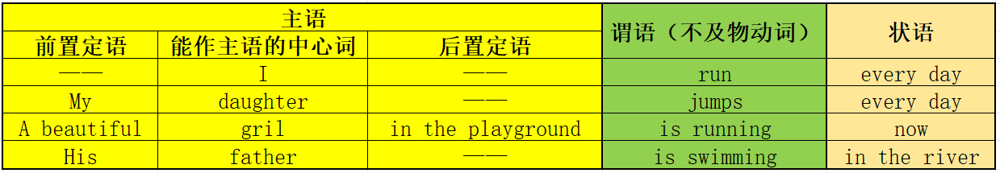
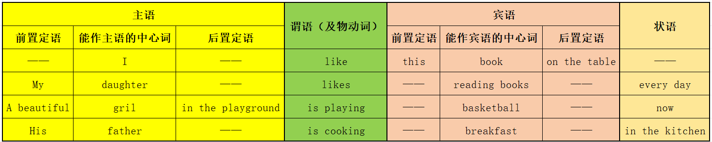
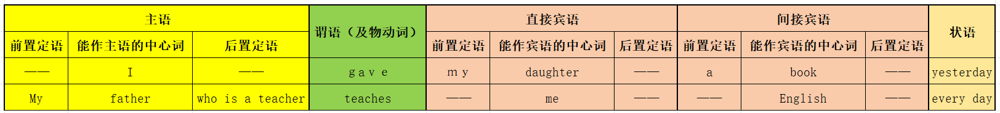
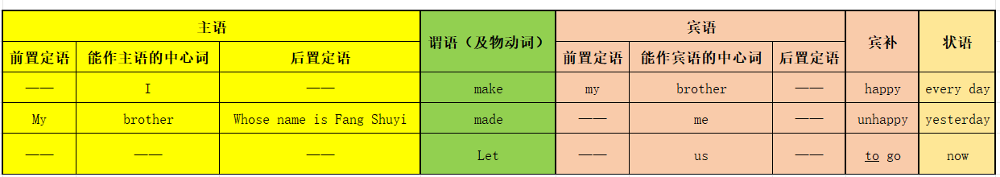
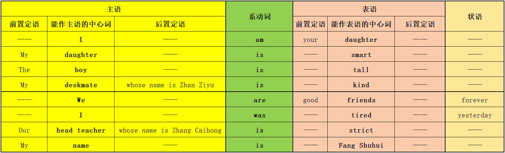
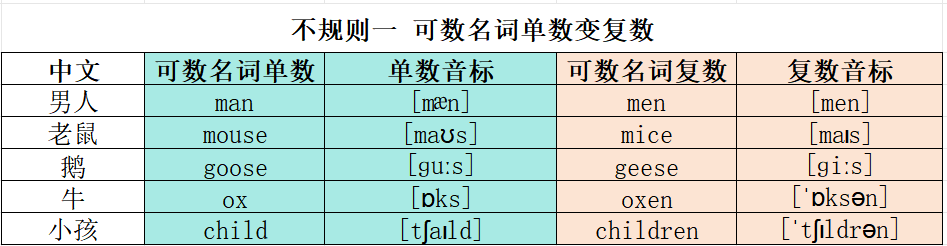
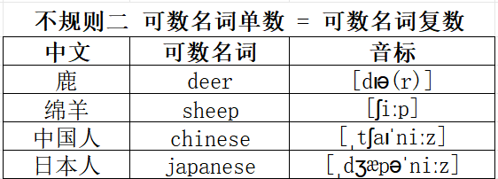
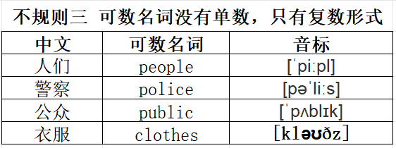

# 第一章 句子成分与基本句型

> 句子成分就是构成句子的各个部分. 英语的句子成分总共有七个: 
>
> 主语/ 谓语/ 宾语/ 表语/ 补语/ 定语/ 状语, 还有一个不太重要的同位语

## 一. 主语

### 1.定义

> 主语就是一句话主要叙述的对象 或者 这句话主要讲的内容.

- <u>我</u>是中国人

- <u>英语</u>学起来不算费事
- <u>张三</u>喜欢踢足球
- <u>学习英语</u>是一件重要的事情

### 2.能够充当主语的词语

> 名词/ 代词/ 数词/ <u>动词不定式或动词不定式短语</u>/ <u>动名词或动名词短语</u>/ <u>主语从句</u>/ <u>其它</u>
>
> | 名词                         | 代词(人称代词主格 + 指示代词) | 数词 |
> | ---------------------------- | ----------------------------- | ---- |
> | 动词不定式 或 动词不定式短语 | 主语从句                      | 其它 |
> | 动名词 或 动名词短语         |                               |      |

#### (1)名词

> 名词就是世间万物的名称

- 人名: Fang Shuhui
- 地名: China/ Guang Dong
- 看得见的物品: 电脑/ 手机
- 看不见得事物: 空气/ 风/ 声音

> 举例:
>
> Fang Xing is a teacher. 房兴是一名老师.
>
> Fang Shuhui is a student. 房书卉是一名学生.
>
> Guang Dong is beautiful. 广东是美丽的.
>
> The computer is expensive. 这台电脑贵.
>
> Fang Shuhui likes this book. 房书卉喜欢这个本书.

#### (2)代词

> 包括人称代词和指示代词
>
> 代词就是为了避免重复而代替名词的词语
>
> 英语不喜欢重复, 甚至不能容忍重复

- 人称代词

  Fang Shuhui is a student. Fang Shuhui is a girl. Fang Shuhui likes reading books.

  Fang Shuhui is a student. She is a girl. She likes reading books.

  人称代词分为主格 和 宾格:

  - 主格: I (我)/ we (我们) / you (你, 你们)/ she (她)/ he(他)/ it(它)/ they(他们, 她们, 它们).主格只能作主语
  - 宾格:me   /  us            /  you                /  her       / him   / it      /  them                           .宾格只能作宾语

> 举例:
>
> I am a teacher.
>
> We are happy.
>
> You are a student.
>
> She likes computers.
>
> He is a boy.
>
> It is a dog.
>
> It is cheap.
>
> They are my students.

- 指示代词

> 指示代词包括: this(这个), that(那个), these(这些), those(那些)
>
> 举例:
>
> This is my pen.
>
> That is my computer.
>
> These are my books.
>
> Those are bad.

#### (3)数词

> 数词分为: 基数词 和 序数词 
>
> - 基数词: 1, 2, 3,   one, two, three, four, five, six, seven, eight, nine, ten, eleven...
> - 序数词: 第一, 第二, 第三  first, second, third, fourth...
>
> 举例:
>
> - Eight is a lucky number. 八是一个幸运的数字.
> - The first is very important. 第一是非常重要的.

#### (4)动词不定式或动词不定式短语

> 只作了解:
>
> Eat is important. (X)
>
> To eat is important. (√) To + 不及物动词原形 构成动词不定式,可作句子的主语
>
> Learn English is easy.(X)
>
> To learn English is easy.(√) To + 及物动词原形+ 宾语 构成动词不定式短语,可作句子的主语

#### (5)动名词或动名词短语

> 只作了解:
>
> Eat is important. (X)
>
> Eating is important.(√) 动名词, 可作句子的主语
>
> Learn English is easy.(X)
>
> Learning English is easy.(√)动名词 + 宾语 构成动名词短语, 可作句子的主语

#### (6)主语从句

> 只作了解:
>
> What my daughter wants is a book.

#### (7)其它

> - 在英语里面,有些词语看起来不是名词,但是具有名词的含义.比如,old本来是形容词,也就是"老的"意思,但是加上the之后就变成了名词的含义了,the old表示 "老人"的意思,所以可以作主语.
>
>   类似的词语还有: the poor 穷人/ the rich 富人
>
>   The rich should help the poor.
>
> - 当你想**谈论单词、符号、字符串本身（而不是用它表达意思）**，给它加上引号，它就变成一个名词性的主体，可以做主语.例如"eat"  , "run"  
>
>   "Eat" is an English word.
>
>   "Run" is an English word.

## 二.谓语

> 谓语就是说明**主语动作或状态的词语**.
>
> 或者这样理解，谓语是说明主语做什么，或者主语是什么/怎么样的词语.
>
> 谓语分两类:动作型谓语 和 状态型谓语

### 1.动作型谓语

#### (1)简单谓语

> - 实义动词.就是表示有实际意义的动词, 注意和 系动词,助动词,情态动词区分开来(这些动词后面具体讲).
>
> 举例:like(喜欢)/say(说)/eat(吃)
>
> I like this book.
>
> I say hello to you every morning.
>
> I eat breakfast every morning.
>
> - 动词短语.
>
> 举例:look after(照顾)/get up(起床)/look at(看)
>
> I look after my daughter every day.
>
> I get up at six.
>
> I am looking at Zhan Ziyu. 

#### (2)复合谓语

> 复合谓语 = 其它词语 + 简单谓语
>
> - 情态动词 + 简单谓语(必须是动词原形). 
>
> 举例: 
>
> can + speak
>
> I can speak English.
>
> can + look after
>
> I can look after you.
>
> 
>
> - 助动词 + 简单谓语.
>
> 助动词是没有意思的, 只是用来帮助构成某种结构,比如:
>
> 时态,否定句,疑问句,被动语态
>
> 举例:
>
> 构成一般将来时态
>
> will + play(简单谓语必须是动词原形)
>
> I will play badminton with Liu Xiru tomorrow.
>
> 
>
> 构成否定句
>
> don't + like  (这里的do就是助动词  don't = do + not)
>
> I don't like you.  
>
> 
>
> 构成一般疑问句
>
> I like you.(肯定句,如何变成一般疑问句)
>
> Do you like me?
>
> 
>
> 构成被动语态
>
> 助动词 + 谓语(动词过去分词)
>
> My computer was built in 2022.

### 2.状态型谓语

> 状态型谓语 = 系动词 + 表语
>
> - 系动词分两种
>
>   - be动词(使用最多的情况)
>
>   | ***be*** | ***am*** | ***is*** | ***are*** | ***was*** | ***were*** | ***been*** | being |
>   | -------- | -------- | -------- | --------- | --------- | ---------- | ---------- | ----- |
>
>   - 看起来是实义动词,但其实是系动词(用的没有be动词多,但是一出现要特别小心)
>
>   举例: I feel tired.     主语  +  系动词  +  形容词
>
> - 状态型谓语举例:
>
> I am happy.
>
> She is happy.
>
> They are happy.
>
> I feel tired.

## 三.表语

表语和系动词是分不开的,没有系动词就没有表语,没有表语就没有系动词

### 1.定义

说明主语的情况或主语的状态的词语.

### 2.能作表语的词语

| 名词                      | 形容词     | 代词     |
| ------------------------- | ---------- | -------- |
| 介词短语                  | 名词所有格 | 数词     |
| 动词不定式/动词不定式短语 | 副词       | 过去分词 |
| 动名词/动名词短语         | 表语从句   |          |

先用名词 / 形容词 / 介词短语 来理解表语.

>- 名词作表语
>
>I am Fang Shuhui.
>
>Liu Xiru is my friend.
>
>We are students.
>
>- 形容词作表语
>
>I am happy.
>
>He is fat.
>
>- 介词短语
>
>I am on the bed.
>
>My brother is in the washroom.

## 四.宾语

### 1.定义

宾语就是动作的对象或承受者. 宾语一定出现在“主语 + 谓语(及物动词) + 宾语”句式中, 和"主系表"句型没有任何关系.

>  及物动词后面一定要跟一个动作的对象或承受者, 也就是宾语. 因为如果没有宾语, 及物动词就没有意义了, 表达也不完整了.
>
> 举例: buy  买, buy是一个典型的及物动词
>
> I buy.  我买  (X)
>
> I buy bread every weekend. (√)
>
> like 喜欢
>
> I like. 我喜欢(X)
>
> I like books. 我喜欢书(√)

### 2.能做宾语的词语

> 能作主语的词语都可以作宾语, 所以主语会了, 宾语也就会了. 
>
> 这里要注意, 人称代词作宾语的时候要用宾格, 从句作宾语的时候叫宾语从句.
>
> | 名词                         | 代词(人称代词宾格 + 指示代词) | 数词 |
> | ---------------------------- | ----------------------------- | ---- |
> | 动词不定式 或 动词不定式短语 | 宾语从句                      | 其它 |
> | 动名词 或 动名词短语         |                               |      |
>
> - 谓语后只跟一个宾语的情况(最常见)
>
>   - 名词作宾语
>
>   I buy a book every year.
>
>   I buy apples every day.
>
>   My daughter likes books.
>
>   I believe Fang Shuhui.
>
>   - 人称代词宾格作宾语
>
>   I love her.
>
>   I believe her.
>
>   - 数词作宾语
>
>   I want two. 我想要两个
>
>   I have three. 我有三个.
>
> - 谓语后跟两个宾语(情况不多, 有一些特定的及物动词可带两个宾语,这种动词叫:双宾动词)
>
> 常见的双宾动词:
>
> | give(给) | teach(教) | tell(告诉) |      |
> | -------- | --------- | ---------- | ---- |
> |          |           |            |      |
> |          |           |            |      |
>
> 公式: 谓语(双宾动词) + 间接宾语(表示人, 人称代词宾格或姓名) + 直接宾语(表示物,  物品名称)
>
> 注意, 这里的 间接宾语 和 直接宾语 是并列的两个宾语, 互相没有逻辑主谓/主表的关系
>
> 举例:
>
> I gave you a book.
>
> I teach you English every day.
>
> I tell Fang Shuyi stories every night.

## 五.宾语补足语

在英语里面, 有些动词加上宾语后, 意思还是不完整

比如下面的动词:

| make(使, 让) | let(让)   | have(让,使) | put(放)    |
| ------------ | --------- | ----------- | ---------- |
| call(叫)     | see(看见) | keep(保持)  | find(发现) |
| get(让)      |           |             |            |

这个时候, 需要加上一个词语补充宾语的意思, 使整个句子意思完整.这个补充的词语就叫 宾语补足语, 简称宾补.

注意, 宾语 和 宾补 之间存在逻辑主谓/主表的关系(宾语是逻辑主语, 宾补是它的谓语/表语)

能作宾补的词语有:

|          形容词           | 名词     | 数词 |
| :-----------------------: | -------- | ---- |
| 动词不定式/动词不定式短语 | 副词     | 分词 |
|     动名词/动名词短语     | 介词短语 | 从句 |

举例:

> - 形容词作宾补
>
> I make you happy every day.
>
> I make English classes effective.
>
> - 名词作宾补
>
> I call her Fang Shuhui.

## 六.状语

### 1.定义

状语就是说明谓语的情况, 状语只跟谓语有关系.

中文举例:

- 我今天很开心
- 我在第三小学上学

中文的状语一般放在句子的中间

英文举例:

- I am happy today. 
- I study at the Third Primary School.

英文的状语一般放在句子的后面

### 2.状语的分类

时间状语/ 地点状语/ 方式状语/ 目的状语/ 原因状语等

### 3.能作状语的词语

状语一般由 副词 和 介词短语 充当

> 举例:
>
> I am busy today. 
>
> I study at the Third Primary School.
>
> He runs quickly.

## 七.定语

### 1.定义

修饰或限定名词的词语叫定语.

定语只跟名词有关系, 哪里有名词, 哪里就有定语.

不管在什么语言里, 名词都是需要定语的, 否则名词的范围就太宽泛了.

 注意:只有普通名词才可以带定语, 专有名词(如人名, 地名, 国家名)不带定语.

举例:

去买苹果.  Please buy apples.

去买10个苹果.  Please buy ten apples.

去买10个大一点的苹果. Please buy ten big apples.

我的书 my book

美丽的姑娘  a beautiful girl

### 2.分类

在英语中, 定语分为 前置定语 和 后置定语.

- 前置定语

  - 限定词
    - 形容词性物主代词, 如my, your, her, his...     my book
    - 名词所有格, Fang Shuhui's   father's     Fang Shuhui's pen
    - 数词 three third      three books      The Third Primary School 
    - 指示代词 this that these those      this book   that girl
    - 冠词 a/an/the    a book/an apple/the book
    - <u>量词 two bottle of     two bottle of water</u>(之后再讲)
  - 修饰语
    - 名词 English     English book
    - 形容词  big, small, happy    happy girl
  - 限定词 + 修饰语
    - my English book
    - Fang Shuhui's English book
    - three red pens
    - this big house
    - a smart girl

- 后置定语(非常重要! 要适应英语的这个习惯!)

  - 介词短语  
  - 名词所有格(of  +  名词)
  - 动名词短语
  - 动词不定式短语
  - 定语从句

  以介词短语作后置定语举例:

  The book on the table is Fang Shuhui's.

  Three children in the park are very happy.   

  The girl with a book is my daughter.

## 八.同位语

### 1.定义

两个不同的词语都表示同一个人,或表示同一个物.

同位语起到强调补充说明的作用.

句子中先出现A,再出现B, 一般情况下B叫做A的同位语

### 2.分类

- 前面名词已经确定是谁 → 加逗号，只是起补充说明作用，是**非限制性同位语**，逗号不能省。

My father, a good teacher, is learning English.

- 前面名词范围宽泛、需要靠后面这个词锁定是哪一个 → 不加逗号，起限定作用,是**限制性同位语**

The boy Jack is a good student.

## 九.五个基本句型

- 表动作

### 1. 主语 + 谓语(不及物动词) + 状语

### 2. 主语 + 谓语(及物动词) + 宾语 + 状语

### 3. 主语 + 谓语(及物动词中少数双宾动词) + 间接宾语 + 直接宾语 + 状语

### 4. 主语 + 谓语(及物动词中少数宾补动词) + 宾语 + 宾补 + 状语

- 表状态

### 5. 主语 + 系动词 + 表语 + 状语

# 第二章 名词

## 一.定义

>  世间万物的名称

## 二.分类

名词分为 普通名词 和 专有名词

### 1.普通名词

#### 1.1 可数名词

> 可数名词就是那些肉眼能分清楚的名词, 比如: 书, 房子, 电脑等.
>
> 每个可数名词都有两种格式: 单数格式	和	复数格式
>
> 复数格式都是由单数格式变化而来的. 大部分名词单数变复数都是有规则的变化, 少数情况存在不规则的变化.

##### 1.1.1 可数名词单数变复数变化规则

要遵循一个原则, 就看单词的末尾字母

###### 1.1.1.1 以字母 s / x / sh / ch / z 结尾的单词

规则: 可数名词单数->复数, 结尾+es

举例:

公共汽车 bus	->	buses

盒子 box	->	boxes

刷子 brush	->	brushes

手表 watch	->	watches

注意, 中小学期间以z结尾的名词就是下面两个

嗡嗡声 buzz  ->  buzzes

小测验 quiz   ->  quizzes  注意: 结尾+zes

思考:

glass	-> glasses

fox	->foxes

dish	->dishes

match	->matches

###### 1.1.1.2 辅音字母+y结尾的单词

规则: 变y为i, 再加es

元音字母: a / e / i / o / u	辅音字母: 其余的21个字母

举例:

baby	->	babies

country	->	countries

story	->	stories

思考:

dictionary	->	dictionaries

boy	->	boys

toy	->	toys

###### 1.1.1.3 以f / fe 结尾的单词

规则: 变f 或 fe  为 v, 再加es

举例:

wife	->	wives

thief	->	thieves

思考:

knife	->	knives

leaf	->	leaves

wolf	->	wolves

以下10个单词例外:

roof -> roofs 房顶	      gulf -> gulfs 海湾	cliff -> cliffs 悬崖

safe -> safes 保险箱	  belief->beliefs 信念	proof->proofs 证据

reef->reefs 礁石		turf->turfs 草皮		cuff->cuffs 袖口

giraffe->giraffes

###### 1.1.1.4 英雄喜欢西红柿和土豆

西红柿 tomato  -> tomatoes

土豆  potato -> potatoes

英雄 hero  -> heroes

只有以上三个以o结尾的可数名词单数, 变复数+es

可以通过下面的句子来记忆:

Heroes like tomatoes and potatoes.

英雄 喜欢 西红柿和土豆

###### 1.1.1.5 其余可数名词单数变复数的规则

规则: 可数名词单数 变 复数 , 结尾 + s

pen -> pens

cup -> cups

book -> books

computer -> computers

piano -> pianos

思考:

teacher ->teachers

school  ->schools

girl ->girls

toy ->toys

bamboo ->bamboos

orange ->oranges

##### 1.1.2 可数名词变复数后的发音

可数名词变复数后,  在结尾会有如下变化:

- 以s / x / sh / ch / z结尾的单词, +es. 单词结尾是es

- 以辅音字母+y 结尾的单词, 变y为i, +es. 单词结尾是ies
- 以f / fe 结尾的单词(除了那9个单词), 变f/fe 为 v, +es. 单词结尾是ves
- hero, tomato, potato , 单词结尾是es
- 其余 + s. 单词结尾是s

以上这些结尾, 就发三种音 /s/	/z/	/ɪz/ , 如何对号入座呢?

*要遵循一个原则, 单词原形最后的音(注意不是字母!), 决定结尾发哪个音

###### 1.1.2.1 什么时候结尾读/ɪz/

音标结尾是 /s/  /ʃ/  /tʃ/  /z/   /dʒ/, 结尾读/ɪz/

举例: 

bus /bʌs/   ->   buses /ˈbʌsɪz/

box /bɒks/  -> boxes /ˈbɒksɪz/

brush /brʌʃ/  -> brushes /ˈbrʌʃɪz/

watch /wɒtʃ/  -> watches /ˈwɒtʃɪz/

嗡嗡声 buzz /bʌz/ → buzzes /ˈbʌzɪz/

小测验 quiz /kwɪz/ → quizzes /ˈkwɪzɪz/（重中之重，必考拼写坑：双写 z 再加 es）

orange /ˈɒrɪndʒ/ -> oranges / ˈɒrɪndʒɪz /

###### 1.1.2.2 什么时候结尾读/z/

- 当单词音标结尾为元音音素(包括所有元音音素)

boy /bɔɪ/ -> boys /bɔɪz/

zoo /zuː/  -> zoos /zuːz/

- 当单词音标结尾为这些浊辅音音素：/b//d//g//v//m//n//ŋ//l//r/  /ð/

出租车 cab /kæb/ ->  cabs /kæbz/

床 bed /bed/ -> beds /bedz/

包  bag /bæɡ/  ->  bags /bæɡz/

小刀 knife /naɪf/  ->  knives /naɪvz/    注:原形尾 /f/，变复数才变成 /v/.  除了那9个特殊的单词,  所有结尾是f / fe的单词都遵循这个规则

房间 room /ruːm/  ->  rooms /ruːmz/

钢笔 pen /pen/  ->  pens /penz/

东西 thing /θɪŋ/  ->  things /θɪŋz/

球 ball /bɔːl/  ->  balls /bɔːlz/

星星 star /stɑːr/  ->  stars /stɑːrz/

- 这三个单词, 变复数时出现了浊化: /θ/ -> /ð/

嘴 mouth /maʊθ/ → mouths /maʊðz/

小路 path /pɑːθ/ → paths /pɑːðz/ 

浴缸 bath /bɑːθ/ → baths /bɑːðz/ 

###### 1.1.2.3 什么时候结尾读/s/

当单词音标结尾为这五个**清辅音** /p/ /t/ /k/ /f/ /θ/时

地图 map /mæp/ → maps /mæps/

猫 cat /kæt/ → cats /kæts/

桌子 desk/desk/ → desks /desks/

房顶 roof /ruːf/ → roofs /ruːfs/

月份 month /mʌnθ/ → months /mʌnθs/

##### 1.1.2 可数名词单数变复数不规则变化

> 可数名词变复数的不规则变化的情况是少数的, 不用死记硬背, 平时用这些词多造句, 自然就记住了.

#### 1.2 不可数名词

> 不可数名词没有复数的格式, 只有单数的格式.
>
> 不可数名词是单数概念, 所以它作主语时, 后面的谓语动词要变单数格式.
>
> 举例:
>
> ​	主系表: 
>
> ​		water  are  important. (X)
>
> ​		Water   is  important. (√)
>
> ​	主谓状:
>
> ​		榴莲: durian /ˈdʊəriən/
>
> ​		强调榴莲果肉、榴莲这种食物本身，这时Durian不可数
>
> ​		强调一个榴莲，二个榴莲，这时Durian可数
>
> ​		Durian sell well. （X）
>
> ​		Durian sells well.  (✓)

### 2.专有名词

> 专有名词是表示 地名, 人名, 团体,  机构,  组织等 专有的名称.
>
> 专有名词一般表示独一无二的事物, 第一个字母要大写.
>
> 分类:

#### 2.1无定冠词的专有名词

##### 2.1.1 人名

李伟 Li Wei

房兴 Fang Xing

房书卉 Fang Shuhui

房书屹 Fang Shuyi

注意:如果人名前有尊称或头衔, 包括身份, 地位, 称号等, 这些名词的第一个字母也要大写,例如:

Professor Zhang 张教授

##### 2.1.2 称呼

当 **直接称呼（呼语）**，或者 **单独用来指代 “我的爸爸 / 妈妈”、相当于人名来用，前面没有 my/your/the** → 首字母大写

- Dad, come here. 爸爸，过来
- Mum is cooking. 妈妈正在做饭
- Thank you, Mother. 谢谢你，妈妈

小写场景（前面有 my/your）

My dad likes durian.

##### 2.1.3 星期, 月份

星期一  Monday

三月  March

Monday is fun.

I like March.

##### 2.1.4 节日

一般为结尾为day 的节日

- Children’s Day  儿童节
- Teachers’ Day  教师节
- National Day  国庆节
- New Year’s Day  元旦

We have fun on **Children’s Day**.

##### 2.1.5 地点, 地名

China 中国

Asia 亚洲

Beijing 北京	注意:BeiJing, Bei Jing(X)

Guangzhou

Harbin 哈尔滨	哈尔滨不是直接按 hā-ěr-bīn 拼成 Haerbin，这是特殊地名（源自满语）

Suifenhe 绥芬河

Mudanjiang 牡丹江

Heihe 黑河

I   live  in  Suifenhe.  我住在绥芬河. 结构:主语 + 谓语(不及物动词) +　地点状语

#### 2.2 前面加定冠词the的专有名词(讲到冠词的时候, 再补充这个内容)

> pass

#### 2.3 专有名词总结

可数、不可数这套划分，就是针对普通名词的。

 普通名词（有可数 / 不可数属性）： 普通名词是一类事物的统称，既能用来讲【这一整类】，如 rice, water；也能用来讲【这一类里面特定的某一个 / 某一些】，比如 the apple。

绝大多数专有名词本身不讨论可数 / 不可数，它和普通名词的可数性体系，不是一套逻辑。 

专有名词（原生无可数性）： 用来指代独一无二、特定的人 / 事物的名称，默认就只有那一个。

 Beijing、Tom、Monday、May 作用：特指某一个特定个体的名字

## 三.作用

### 1.作主语

The book is new.

These books are new.

Water is important.

Fang Shuhui is my daughter.

Fang Shuhui likes reading books.

Children's Day is fun.

### 2.作表语

My daughter is a student.

This is an English book.

My mother is an IT teacher.

### 3.作宾语

My daughter has many clothes.

My brother has many toys.

I gave my daughter a book yesterday.

### 4.作宾补

I call him Jack.

My daughter calls  this rabbit Nuo Tuan.

I will make him a good boy. 

### 5.作定语中的修饰语

什么样的名词可以做前置定语中的修饰语？

**大多是可数名词单数形式**，用来表示【用途、类别、材料、地点、时间、性别】，注意这里起到和形容词一样的作用，即修饰语，是“锦上添花”。

##### 5.1 **用途 **

后面的东西用来干什么

**pencil** box 铅笔盒	**train** station 火车站	**car** door 车门

**coffee** cup 咖啡杯   	**shoe** shop 鞋店

##### 5.2 **类别** 

描述后面的名词是哪一类、什么内容

**school** bus 校车        **cat** food 猫粮

**English** book 英语书 	**music** teacher 音乐老师	**science** lab 科学实验室

**apple** tree 苹果树

##### 5.3 **材料**  

后面的东西用什么做的

**stone** bridge 石桥	**glass** bottle 玻璃瓶	**wood** desk 木桌

##### 5.4 **地点**  

在哪里用，或属于哪里

**city** park 城市公园	**country** road 乡间小路 	 **school** gate 校门

**city** library 市图书馆 	  **kitchen** table 厨房餐桌

##### 5.5 **时间** 

什么时候用、什么时候发生

**summer** holiday 暑假	**morning** exercise 早操	**evening** news 晚间新闻	**summer** camp 夏令营

##### 5.6 性别

标明职业者性别

**woman** teacher 女教师		**boy** student 男学生

**注意：**

1. 中心词是可数名词单数，整个短语前一般要有限定词：a / the / my / this 等。
2. 不想加限定词，就把中心名词变复数。
3. 前置的名词定语本身通常保持单数。
4. 中心词是不可数名词，泛指时可以不加限定词；特指仍要加 the / my / this 等。

**例子：**

- a pencil box — I have a pencil box.（单数，加 a）
- two pencil boxes — I have two pencil boxes.（复数，加 two）
- my pencil boxes — My pencil boxes are expensive.（复数，加 my）
- pencil boxes — Students need pencil boxes.（复数，零冠词泛指）
- apple juice — I like apple juice.（不可数，泛指，零冠词）
- this apple juice — I choose this apple juice.（不可数，特指，加 this）

#### 6.作同位语

同位语前后加逗号 → 非限定同位语，只是补充说明，删掉句子照样成立； 

同位语不加逗号贴在一起 → 限定同位语，用来区分、锁定是哪一个，一般不能随便删。

- 前面名词已经确定是谁 → 加逗号，只是起补充说明作用，是**非限制性同位语**，逗号不能省。

My father, a good teacher, is learning English.    删掉同位语后依然合理->My father is learning English. 

My hometown, Suifenhe, is a beautiful city. 删掉同位语后依然合理->My hometown is a beautiful city. 

- 前面名词范围宽泛、需要靠后面这个词锁定是哪一个 → 不加逗号，起限定作用,是**限制性同位语**

The boy Jack is a good student.  删掉同位语后语法成立,但表达模糊,不合理  The boy is a good student. 

My friend Lucy is a teacher. 删掉同位语后语法成立,但表达模糊,不合理 My friend is a teacher.

#### 7.作介词宾语

in这个介词为例,  介词 + 名词组成介词短语
in the room 在屋子里

举例:

He is in the room.   in the room这个介词短语作表语

He jumps in the room every day. in the room作地点状语  整个句子:主语 + 谓语(不及物) + 地点状语 + 时间状语

### 四.名词所有格

# a /an 不定冠词完整总结（按逻辑分类，和咱们前面全部例子对应，拒绝死记硬背）

> 底层本质：**a/an 只能搭配【单数可数名词】；核心含义：one（一个），但在不同语境下分化成 4 种功能；元音音素开头用 an，辅音音素开头用 a** 重要前提：单数可数名词**不能裸奔**，只要它是单数可数，又不是特指（不用 the），大多要 a/an

## ① 首次引入（课本原话那条）

✅ 特征：第一次提起**某个特定个体**，后文通常会用 the 回头指代同一个东西 ✅ 逻辑：先把这个对象带进对话，后面锁定它 ✅ 例句： I have a pen. The pen is blue. I see a dog. The dog is black. ✅ 关键点：a 这一步还不是特指；the 才是特指

## ② 任指（同类里任意一个，随便一个）

✅ 特征：不锁定特定个体，没有后文 the 回指；动作只是取同类当中随便一个 ✅ 例句： I eat an egg every day. I want a banana. I need a pen. ✅ 关键点：侧重 “拿一个来用 / 吃 / 要”，不是讲类别共性，也不准备接着聊这一个

## ③ 类指（用单个样本代表整个一类事物，讲类别固有属性、本能）

✅ 特征：主语居多，描述这一类东西天生自带的特点；可以等价换成复数零冠词类指 ✅ 例句： A cat likes fish. = Cats like fish. A plane flies fast. = Planes fly fast. A bird can sing. = Birds can sing. ✅ 关键点：翻译常常不用硬翻 “一个”，讲群体共性

## ④ 归类用法（be + a + 名词，说明身份、归属类别）

✅ 特征：放在系动词 am/is/are 后面作表语；表示主语是该群体中的一员 ✅ 例句： I am a teacher. He is a doctor. It is a dog.（这个动物属于狗这一类） ✅ 区分对比： A teacher helps students.（纯正类指：老师这个群体的特点） I am a teacher.（归类：我属于老师中的一员）

------

# 快速区分判断流程（做题优先用这个顺序）

拿到 `a/an + 单数可数名词`，依次自问：

1. 后面有没有 the 回头指代**同一个东西**？→ 有 = 首次引入
2. 句子是不是在讲这一类事物天生的习性 / 特征？→ 是 = 类指
3. 是不是在 be 后面，用来标明身份、归类？→ 是 = 归类用法
4. 以上都不是，只是动作里随便取一个 → 任指

# 配套重要补充规则

1. a /an 的选择看**发音（音素）**，不看字母： an apple /an hour（h 不发音，元音开头）；a university（u 发音是 /j/ 辅音）
2. 共同限制：**不能搭配复数名词、不可数名词**（不能 a water，a books）
3. 和 the 的分界线：a/an = 不特指；the = 特指（双方都清楚是哪一个）

# 一句话极简浓缩版（方便背诵）

> a/an 四用途：引个体（后接 the）、任一个、表一类、归身份； 元音音素前面 an，辅音音素前面 a；只跟单数可数名。

------

# 自测 5 题（覆盖全部 4 种，你可以试着标注类型）

1. A bike has two wheels.
2. I find a key. The key is mine.
3. She is a nurse.
4. I’d like a cup of tea.
5. A dog likes meat.

